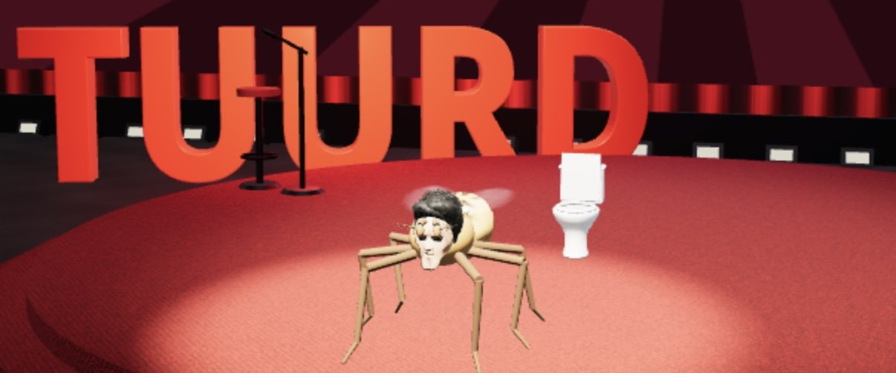
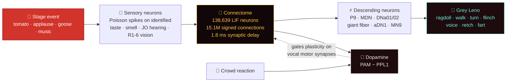
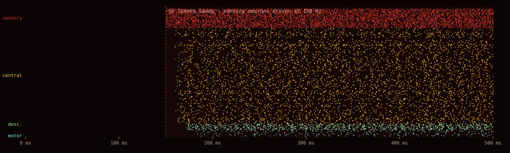

<div align="center">

<a href="https://flyleno.viosarcade.xyz/"></a>

# 🪰 Grey Leno Fly Brain

**A whole fruit-fly brain runs a late-night talk show in your browser.**

138,639 real *Drosophila* neurons, wired exactly as the FlyWire connectome maps them,<br>
fire spike by spike and puppeteer **Grey Leno** on the TUURD Talk stage.

[](https://flyleno.viosarcade.xyz/)
[](https://spikecalls.github.io/grey-leno-fly-brain/)


</div>

---

## What is this?

**FlyLeno** is a browser toy with a real neuroscience engine inside.

- The **brain** is a whole-brain spiking model of the adult fruit fly: every one of its 138,639 neurons and 15.1 million connections from the [FlyWire](https://flywire.ai/) connectome, simulated as leaky integrate-and-fire cells in a Web Worker, in plain JavaScript.
- The **body** is Grey Leno, a physics ragdoll on a TUURD-Talk-style stage built in three.js.
- The **show** is you. Throw tomatoes, pipes, roses and sugar. Book a goose. Start a tomato storm. Every event stimulates the fly's real sensory neurons, and Leno does whatever its descending neurons tell him to.

Nothing at the motor level is scripted. When Leno walks, it is because `P9` neurons fired. When he backs away from a heckler, that is `MDN`, the moonwalker neuron. When he flinches, the giant fiber (`DNp01`) crossed threshold.

<div align="center">

<br><sub>Live in the browser. The spotlight, the mic stand, the toilet. The fly brain is doing all of it.</sub>
</div>

## 🧠 From tomato to twitch



This is what that looks like inside a network. A real raster from the toy brain in [`src/lif.js`](src/lif.js): silence, then a tomato lands at 150 ms and the activity cascades from the senses to the motor neurons.

<div align="center"></div>

## ⚡ The wiring the show touches

Counts are the identified FlyWire neurons each input drives and each output reads, taken from the running build.

<table>
<tr><td valign="top" width="50%">

| Stage input | Cell types | Cells |
|---|---|--:|
| 👏 Applause | JO-C/E/F antennal | 209 |
| 🍅 Rotten tomato | LB1 bitter GRNs | 42 |
| 🤢 Smells bad | Or56a (geosmin) ORNs | 39 |
| 🧊 Sugar / snack | LB2d, LB3 sugar GRNs | 129 |
| 📣 Heckler looms | LC4 looming detectors | 104 |
| 🎵 Music, low | JO-B, 30–300 Hz | 259 |
| 🎵 Music, high | JO-A, 0.3–4 kHz | 99 |
| 🍌 Fruit smell L / R | DM1–4, VA2 ORNs | 150 / 140 |
| 👁️ What Leno sees | R1-6 per eye | 400 / 400 |

</td><td valign="top" width="50%">

| Behaviour | Cell types | Cells |
|---|---|--:|
| Walk forward | P9 (DNp09, DNg97) | 4 |
| Back up | MDN | 4 |
| Turn L / R | DNa01, DNa02 | 2 / 2 |
| Startle | Giant fiber DNp01 | 2 |
| Groom | aDN1 (DNg62) | 2 |
| Feed / talk | MN9 | 2 |
| Voice | DNg02 + DNp13 | 27 |
| Gag / retch | Pharyngeal MNs | 38 |
| Fart | oviDN | 6 |
| Reward / punish | PAM / PPL1 | 307 / 16 |

</td></tr>
</table>

## 🔬 The model, in two lines

Every neuron, every 0.1 ms:

```text
dv/dt = (v₀ − v + g) / τm        v₀ = −52 mV, τm = 20 ms
dg/dt = −g / τs                  τs = 5 ms

v > −45 mV  →  spike, v ← −52 mV, g ← 0, refractory 2.2 ms
every target: g += (signed synapse count) × 0.275 mV, 1.8 ms later
```

These are the equations and parameters of [Shiu et al. 2024, *Nature*](https://www.nature.com/articles/s41586-024-07763-9). Run on the full FlyWire wiring, that model predicted which neurons drive feeding and grooming, and the predictions held up in real flies.

FlyLeno adds three things on top, all optional and labelled in the UI:

1. **Lazy exact integration.** Between inputs a neuron's voltage has a closed form, so a cell is only stepped while it could still reach threshold. That is how 15 million connections run in a browser tab.
2. **Dopamine-gated learning.** The fly's own PAM (reward) and PPL1 (punishment) neurons are driven by the crowd. Their difference, `tanh((PAM − PPL1) / 20 Hz)`, gates a three-factor plasticity rule on every synapse onto Leno's vocal motor neurons. Jokes that get applause get repeated.
3. **Spike-frequency adaptation** and **brain worms**. Toggle them in Brain settings. The worms only eat the cells Leno doesn't need.

Deep dive: [`docs/NEUROSCIENCE.md`](docs/NEUROSCIENCE.md).

## 🎬 Tonight's rundown

**Segments:** Opening · Monologue · Phone-in · Take it away, Johnny! · A word from our sponsor · Technical difficulties · Space scabies telethon · The rotten éclair · Guest: Mr. Frog · Guest: The Jonkler · Guest: Kybo Rin · Guest: a goose · Sunday drive · Grey Leno dance party · Vote Leno · 500 years young · Do The Leno · Spin the Wheel of Leno · Lullaby · Sign-off

**Events:** Goose · Spider-Leno · Swatter glove · Electric racket · Duendes · Clown car · The Rapture · Rain cloud · Mushroom · Falling rig · Tomato / pipe / rose storms · Standing ovation · Sugar shower · Heckler · Stagehand snack · We'll Be Right Back

How to run a show: [`docs/GUIDE.md`](docs/GUIDE.md).

## 🚀 Run the brain yourself

This repo ships a small, readable LIF engine with the same neuron model, plus the landing page.

```bash
git clone https://github.com/SpikeCalls/grey-leno-fly-brain
cd grey-leno-fly-brain
npm test          # 8 tests: rest, Poisson rate, delay, inhibition, refractory cap, motor decode, dopamine, cascade
npm run demo      # a fly brain in your terminal
npm run serve     # the landing page with the live WebGL brain
```

`npm run demo` prints something like this:

```text
     sensory │                    @#@%%###%%%##%*@%#%#%%%%#%%#@%*@@%#@%%%%%%%#@%%#@%#%%%@%@@#%│
     central │                     .=+#%+########*%@###%#####%#%%##@%%###*#%%+%#*#*@%#*#*@@@@#│
  descending │                        +***+*+*++#++#*******+%*+%#=%=%*#++#*+@=#=#+**@+*=#=@*%*│
       motor │                          -=*-#=:**===#@-=*==#*%-#-##***=*@-*-#%#=-=##=%#=**-%@%│
             └────────────────────────────────────────────────────────────────────────────────┘ 400 ms
```

Use the engine in your own code:

```js
import { LIFNetwork, buildCSR, decodeMotor, dopamine } from './src/lif.js';

// neuron 0 excites neuron 1 through 40 synapses
const net = new LIFNetwork(buildCSR(2, [[0, 1, 40]]));
net.stimulate([0], 100);                 // Poisson drive, 100 Hz
net.run(1000, (i, t) => console.log(`neuron ${i} spiked at ${t.toFixed(1)} ms`));
console.log(net.rate([1]), 'Hz');
```

## 🗂️ Repository

```text
grey-leno-fly-brain/
├── src/lif.js              LIF engine · CSR graph · motor decoder · dopamine · toy fly brain
├── test/lif.test.mjs       node:test suite
├── examples/toy-brain.mjs  terminal demo with ASCII raster and motor bars
├── site/                   GitHub Pages landing: WebGL brain + live lab (no build step)
├── scripts/make-art.mjs    regenerates banner.svg and raster.svg from real simulations
├── assets/                 banner, raster, stills
└── docs/
    ├── ARCHITECTURE.md     how FlyLeno is put together, module by module
    ├── NEUROSCIENCE.md     the model, the connectome, learning, what is and isn't biology
    ├── GUIDE.md            how to run a show
    └── SITE-ANALYSIS.md    A-to-Z audit of flyleno.viosarcade.xyz with fixes
```

## 🙏 Credits

- **Brain model:** Shiu et al. 2024, *Nature*, [philshiu/Drosophila_brain_model](https://github.com/philshiu/Drosophila_brain_model) (MIT).
- **Connectome:** FlyWire v783. Dorkenwald et al. 2024 and Schlegel et al. 2024, *Nature*.
- **Stimulus and motor neuron IDs:** partly via [erojasoficial-byte/fly-brain](https://github.com/erojasoficial-byte/fly-brain) (MIT).
- **Grey Leno:** character and original model by **Vinesauce**. Model port by **huckleberrypie**: [Grey Leno for Dead as Disco](https://www.nexusmods.com/deadasdisco/mods/917).
- **Stage:** an original procedural set inspired by the TUURD Talk show of *Nightmare Puppeteer*.

Full list, including every sound: [`CREDITS.md`](CREDITS.md). This is a fan project and is not affiliated with Vinesauce, FlyWire, the authors above, or anyone named Leno.

<div align="center">
<br>
<a href="https://flyleno.viosarcade.xyz/"><b>▶ flyleno.viosarcade.xyz</b></a>
<br><sub>If a fruit fly made you laugh, leave a ⭐</sub>
</div>
