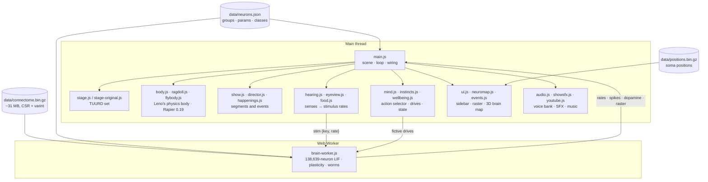

# Architecture

How [flyleno.viosarcade.xyz](https://flyleno.viosarcade.xyz/) is put together. Everything below was read from the live build: plain ES modules, no bundler, three.js 0.170 from jsDelivr via an import map.

## The big picture

The brain lives in its own thread. The main thread never touches a membrane voltage; it only sends stimulus rates in and reads firing rates out.

## Data files

| File | Size (transfer) | What's in it |
|---|--:|---|
| `data/connectome.bin.gz` | ~31.3 MB | Magic `FLYL`, then `N`, `E`, `min_syn`, a CSR row pointer (`N+1` × u32), delta-encoded varint targets and zig-zag varint signed weights. Decompressed in the worker with `DecompressionStream('gzip')`. |
| `data/neurons.json` | 71 KB | Source note, `N = 138,639`, `E = 15,091,983`, `synapses = 54,492,922`, 11 super-classes per neuron, LIF `params`, and the named neuron groups: 23 `stimuli`, 12 `motor`, the plastic `readouts` (Leno's vocal tract) and `muscles` (ragdoll pools). |
| `data/positions.bin.gz` | 796 KB | Soma positions for the 3D "Neural state" map. Missing positions get a deterministic layout. |
| `assets/grey_leno.glb` | 268 KB | The Grey Leno model (huckleberrypie port). |

## The worker (`brain-worker.js`)

- **Model.** Leaky integrate-and-fire, Shiu et al. 2024: `v0 = vReset = −52 mV`, `vTh = −45 mV`, `τm = 20 ms`, `τs = 5 ms`, `tRef = 2.2 ms`, `tDelay = 1.8 ms`, `wSyn = 0.275 mV`, `dt = 0.1 ms`.
- **Lazy exact integration.** The voltage and conductance ODEs are linear, so between inputs a neuron's state has a closed form (`advance(i)`, using pre-computed powers of `e^(−dt/τ)`). A neuron is stepped every `dt` only while `(v − v0)⁺ + PEAK_GAIN · g⁺ ≥ vTh − v0`, the upper bound on its future peak. Everything else is advanced on demand when a spike arrives.
- **Spike delivery.** A ring buffer of `tDelay / dt = 18` slots. Each slot holds the neurons that spiked 1.8 ms ago; their CSR rows are walked and `g` of each target is incremented.
- **Poisson drive.** Stimulated neurons fire as Poisson processes (the 68.75 mV kick of the original always crosses threshold).
- **Read-outs.** Per-group spike counts (motor and stimulus groups), per-muscle counts for the ragdoll, per-neuron counts for the articulators, per-class counts, and a 200-row raster with fixed rows for tagged neurons plus round-robin rows for everything else.
- **Plasticity.** A three-factor rule on every synapse onto the articulator neurons. Eligibility rises on pre-before-post pairings (`τpre = 20 ms`) and decays with `τelig = 1 s`. `DA = tanh((PAM − PPL1) / 20 Hz)`. `Δw = η · DA · e · wSyn`, sign preserved, magnitude clamped.
- **Adaptation** (off by default): each spike raises threshold by 1 mV, decaying with 150 ms.
- **Brain worms** (off by default): silence random neurons that have been quiet for 500 ms and are not sensory, motor or read-out cells, up to 35 % of the brain. Eaten cells survive a brain reset until healed.

## From rates to a body (`motor.js`)

Descending-neuron rates are smoothed with a 250 ms EMA (80 ms for the giant fiber so a single stray spike does not count as a startle) and divided by a saturation rate:

| Command | Source | Saturates at |
|---|---|--:|
| forward | P9 / P9-oDN1 | 40 Hz |
| backward | MDN | 40 Hz |
| turn | DNa01/02 left − right | ±40 Hz |
| startle | giant fiber | 15 Hz |
| groom | aDN1 | 40 Hz |
| feed / talk | MN9 | 40 Hz |

`window.flyleno.motorGains` exposes the gains in the browser console.

## The mind (`mind.js`)

An engineered layer, not part of the connectome. It decides what the fly spontaneously initiates (`talk`, `stroll`, `turn`, `back up`, `fart`, `retch`, `rest`) by switching on "fictive" drives into the matching descending and motor neurons. Each action keeps a value `Q`, credited with the dopamine that arrives within 4 s after it. Choice is `softmax(Q / T)`, with temperature `T = 0.15 + 0.5 · (1 − mood01)`: a miserable fly explores, a happy fly repeats what works.

## What is biology and what is theatre

| Biology (connectome + published model) | Theatre (engineered for the show) |
|---|---|
| Every neuron and connection, signed by neurotransmitter | Phoneme mapping of motor neurons to Leno's voice |
| LIF dynamics and parameters | Action selector ("initiative") |
| Which sensory cells a stimulus drives | Audience, crowd reactions, show director |
| Which descending cells a behaviour reads | Stage-edge reflex, ragdoll, brain worms |
